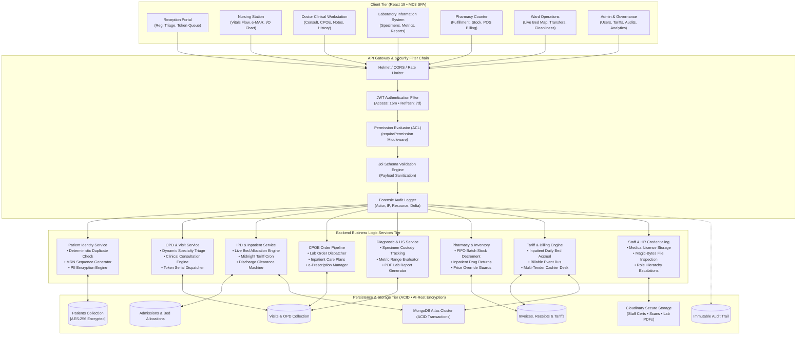
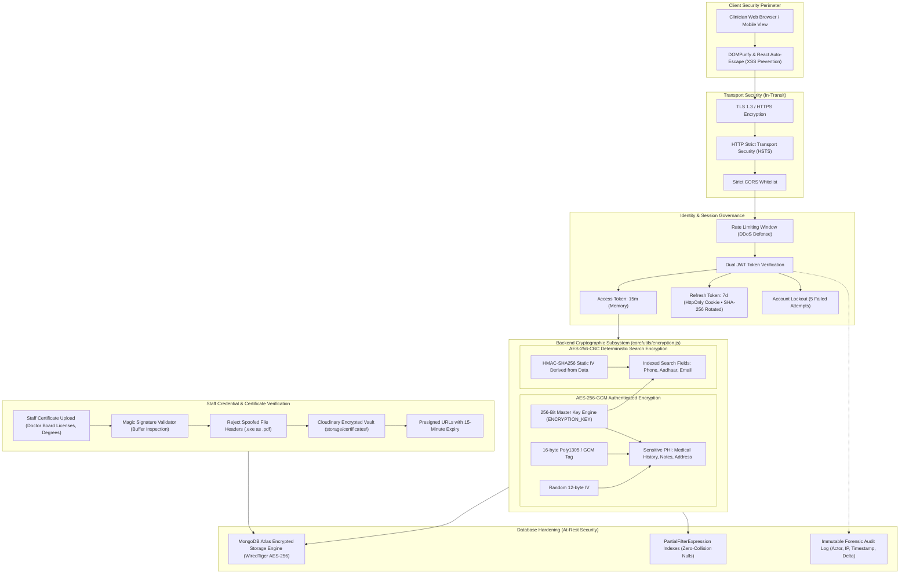

# Quantum CareOne — Enterprise Hospital Management System (HMS)

<div align="center">

[-00668B?style=for-the-badge&logo=react)](https://react.dev/)
[-00668B?style=for-the-badge&logo=materialdesign)](https://m3.material.io/)
[](docs/security/)
[](docs/security/)
[](#)

<p align="center">
  <b>An enterprise-grade, role-based Hospital Information System (HIS) engineered for high-throughput Outpatient (OPD) and Inpatient (IPD) clinical operations, computerized physician orders (CPOE), dynamic diagnostic workflows, live bed maps, electronic medication administration (e-MAR), automated tariff calculation, and multi-tier cryptographic data protection.</b>
</p>

</div>

---

## 📑 Table of Contents

1. [Executive Overview](#-executive-overview)
2. [Hospital Management System Architecture](#-1-hospital-management-system-architecture)
   - [System Architectural Diagram & Permission Matrix](#system-architectural-diagram--permission-matrix)
   - [Architectural Layers Breakdown](#architectural-layers-breakdown)
   - [Granular Role-Based Access Control (RBAC) & Permissions](#granular-role-based-access-control-rbac--permissions)
3. [Outpatient Department (OPD) Workflow & Patient Lifecycle](#-2-outpatient-department-opd-workflow--patient-lifecycle)
   - [OPD Lifecycle Architecture Diagram](#opd-lifecycle-architecture-diagram)
   - [Phase-by-Phase OPD Clinical Execution](#phase-by-phase-opd-clinical-execution)
4. [Inpatient Department (IPD) Workflow & Patient Lifecycle](#-3-inpatient-department-ipd-workflow--patient-lifecycle)
   - [IPD Lifecycle Architecture Diagram](#ipd-lifecycle-architecture-diagram)
   - [Phase-by-Phase Inpatient Ward & Bed Execution](#phase-by-phase-inpatient-ward--bed-execution)
5. [User Workflow Management Deep-Dive](#-user-workflow-management-deep-dive)
   - [Reception Desk](#1-reception-desk-registration--front-office)
   - [Nurse Triage Desk](#2-nurse-triage-desk-departmental-acuity)
   - [Doctor Consultation Console](#3-doctor-consultation-console-md3-clinical-workstation)
   - [Laboratory Workstation](#4-laboratory-workstation-diagnostic-processing)
   - [Pharmacy & Dispensary Desk](#5-pharmacy--dispensary-desk-medication-fulfillment)
   - [Ward Operations & Bed Map Desk](#6-ward-operations--bed-map-desk-inpatient-management)
   - [Billing & Cashier Counter](#7-billing--cashier-counter-financial-clearance)
   - [Medical Superintendent & Administrator](#8-medical-superintendent--system-administrator)
6. [Security Principles, Cryptographic Architecture & Staff Certification](#-security-principles-cryptographic-architecture--staff-certification)
   - [Security Architecture Diagram](#security-architecture-diagram)
   - [Field-Level Hybrid Encryption (AES-256-GCM & Deterministic CBC)](#field-level-hybrid-encryption-aes-256-gcm--deterministic-cbc)
   - [Staff Credential Verification & Document Certification Architecture](#staff-credential-verification--document-certification-architecture)
   - [Network, Transport & API Perimeter Hardening](#network-transport--api-perimeter-hardening)
   - [Tamper-Resistant Audit Trail & Forensic Logging](#tamper-resistant-audit-trail--forensic-logging)
7. [Installation & Deployment Guide](#-installation--deployment-guide)
   - [Prerequisites](#prerequisites)
   - [Environment Configuration](#environment-configuration)
   - [Dependency Installation](#dependency-installation)
   - [Database Seeding](#database-seeding)
   - [Starting Development Servers](#starting-development-servers)

---

## 🏥 Executive Overview

**Quantum CareOne** provides an end-to-end hospital operational backbone. Modern healthcare centers require strict concurrency control, zero data corruption, absolute patient confidentiality, and friction-free routing between front desk, nursing stations, consulting physicians, diagnostic labs, procedural suites, inpatient wards, pharmacies, and billing counters.

### Key Capabilities
- **Dual Outpatient & Inpatient Workflows**: Support for walk-in OPD consultations, ER trauma queuing, scheduled appointments, and direct or step-up IPD admissions.
- **Interactive Live Bed Map**: Multi-floor visual ward planner displaying real-time occupancy, sanitization cycles, maintenance holds, and automated midnight tariff accrual.
- **Computerized Physician Order Entry (CPOE)**: Structured electronic ordering for labs, medications, nursing care plans, and dietary requirements with instant queue propagation.
- **Dynamic Diagnostics & LIS**: Specimen collection logging, dynamic parameter metric input, reference range validation, and pathologist verification.
- **Electronic Medication Administration (e-MAR)**: Inpatient bedside dose verification, scheduled administration alerts, and fluid balance intake/output (I/O) tracking.
- **Zero-Leakage Inpatient Clearance**: 5-step discharge protocol across medical summary, ward nursing, pharmacy returns, diagnostic sign-off, and cashier clearance before bed release.
- **Field-Level Military-Grade Encryption**: AES-256-GCM authenticated encryption for Protected Health Information (PHI) and deterministic HMAC-derived AES-256-CBC for high-speed indexed search.
- **Credential Storage & Magic-Byte Verification**: Cloud-backed storage for doctor licenses and board certifications with server-side magic-byte header inspection.

---

## 🏗️ 1. Hospital Management System Architecture

The application is architected around a modern decoupled client-server paradigm. The frontend is a React 19 Single Page Application styled with standard Material Design 3 tokens. The backend is an Express/Node.js enterprise micro-modular architecture backed by MongoDB Atlas using multi-document ACID transactions.

### System Architectural Diagram & Permission Matrix



### Architectural Layers Breakdown

#### 1. Client Presentation Tier (React 19 SPA)
- **Material Design 3 (MD3) Design Tokens**: Completely dynamic typography, surface elevation levels, container tones (`surface-container-lowest`, `surface-container-high`), and state layers driven by CSS custom properties.
- **Bento Grid Layout System**: Adaptive, fluid multi-pane layouts with specialized clinical side-sheets and bottom sheets for zero-distraction medical interactions.
- **Resilient React Hooks Pattern**: Modular UI hooks (`useDoctorWorkspace`, `useLabQueue`, `usePharmacyDispense`, `useReceptionDashboard`, `useBedOccupancy`) that completely decouple operational UI views from networking, state caching, and client validations.

#### 2. Security Perimeter & Gateway Tier
- **Defense in Depth**: Strict incoming request filtering utilizing Helmet HTTP headers, CORS origin whitelisting, rate-limiting windows against denial-of-service, and Content Security Policies.
- **Granular ACL Permission Verification**: Every single API route is secured with `requirePermission(PERMISSIONS.<CODE>)`. Role strings are not hardcoded in routes; permissions are resolved dynamically from the authenticated user's active database role.
- **Payload Schema Validation**: Powered by Joi schemas with `.unknown(false)` strict mode or controlled `.unknown(true)` sanitization to prevent mass-assignment vulnerabilities.

#### 3. Enterprise Business Logic Tier
- **Service-Repository Decoupling**: Business domain services (e.g., `ipd-admission.service.js`, `patient.service.js`, `visit.service.js`) orchestrate logic, while repository layers isolate direct Mongoose queries and data-transformation adapters.
- **Event-Driven Billing Architecture**: System-wide `BillableEvents` automatically listen to operational milestones (e.g., `LAB_ORDER_ACCEPTED`, `BED_NIGHT_ACCRUED`, `MEDICINE_DISPENSED`) to push real-time billing line-items into open accounts.

#### 4. Data Persistence & Distributed Storage Tier
- **Multi-Document ACID Transactions**: Mission-critical multi-entity workflows (e.g., admitting a patient, booking a vacant bed, collecting an advance deposit, and generating receipt ledger records) execute inside MongoDB transactions (`session.withTransaction`) to eliminate race conditions and partial failures.
- **Partial Filter Expression Indexing**: High-performance indexes that ignore null or non-existent fields (such as optional Aadhaar or international phone numbers) while enforcing strict global uniqueness on populated strings.
- **Object Storage with Presigned Cloud Access**: Staff certifications, medical degrees, radiology DICOM/JPEG scans, and official lab PDFs are uploaded to dedicated folders with signed, short-lived URLs.

---

### Granular Role-Based Access Control (RBAC) & Permissions

The system operates on an explicit-deny access control matrix. The table below outlines each system role, their operational domain, and assigned permission privileges:

| Role Name | Domain & Clinical Scope | Assigned Granular Permissions |
|:---|:---|:---|
| **Receptionist** | Front-desk patient onboarding, queue generation, appointment booking, basic fee intake. | `PATIENT_REGISTER`, `PATIENT_UPDATE`, `PATIENT_VIEW`, `VISIT_CREATE`, `VISIT_VIEW`, `VISIT_CLOSE`, `BILL_GENERATE`, `BILL_VIEW`, `PAYMENT_RECORD`, `APPOINTMENT_VIEW`, `APPOINTMENT_CREATE`, `APPOINTMENT_UPDATE`, `APPOINTMENT_CANCEL`, `APPOINTMENT_CHECKIN`, `BED_VIEW` |
| **Nurse** | Clinical department triage, vital signs entry, ward flowsheet maintenance, e-MAR execution. | `PATIENT_VIEW`, `VISIT_VIEW`, `VITALS_RECORD`, `NOTE_OPEN`, `BED_VIEW`, `BED_STATUS_UPDATE` |
| **Doctor / Consultant** | Outpatient consultations, CPOE orders, inpatient ward rounds, digital prescriptions. | `PATIENT_VIEW`, `VISIT_VIEW`, `NOTE_UPDATE`, `NOTE_FINALIZE`, `NOTE_AMEND`, `RX_CREATE`, `RX_CANCEL`, `LAB_ORDER_CREATE`, `APPROVE_DELETION`, `APPOINTMENT_VIEW`, `BED_VIEW` |
| **Laboratory Technician** | Sample phlebotomy, diagnostic specimen processing, reference range input, scan uploads. | `PATIENT_VIEW`, `VISIT_VIEW`, `LAB_PROCESS`, `LAB_VERIFY` |
| **Pharmacist** | Outpatient prescription dispensing, inpatient dose fulfillment, stock pricing, POS billing. | `PATIENT_VIEW`, `VISIT_VIEW`, `VISIT_CREATE`, `MEDICINE_DISPENSE`, `BILL_GENERATE`, `BILL_VIEW`, `MEDICINE_PRICE_MANAGE` |
| **Ward Operations** | Inpatient bed map management, room transfers, ward capacity planning, sanitization tracking. | `PATIENT_VIEW`, `VISIT_VIEW`, `BED_VIEW`, `BED_ALLOCATE`, `BED_TRANSFER`, `BED_STATUS_UPDATE`, `FACILITY_VIEW`, `FACILITY_MANAGE`, `DISCHARGE_VIEW`, `DISCHARGE_INITIATE`, `TIME_MONITOR_VIEW`, `HOUSEKEEPING_UPDATE` |
| **Cashier / Billing Officer** | Aggregate invoice auditing, advance deposit reconciliation, insurance claim adjustments. | `PATIENT_VIEW`, `BILL_VIEW`, `BILL_GENERATE`, `BILL_FINALIZE`, `PAYMENT_RECORD`, `ADJUSTMENT_REQUEST`, `ADJUSTMENT_APPROVE` |
| **Administrator / Medical Director** | System governance, staff credentialing, tariff catalog management, forensic audit inspection. | `ALL_PERMISSIONS` (`MANAGE_USERS`, `VIEW_AUDIT`, `PATIENT_DELETE`, `TARIFF_MANAGE`, `FINANCIAL_ANALYTICS`, `LAB_MANAGE`, etc.) |

---

## 🔄 2. Outpatient Department (OPD) Workflow & Patient Lifecycle

The Outpatient Department workflow provides a deterministic, state-driven lifecycle that coordinates reception onboarding, localized departmental nursing triage, physician clinical diagnosis, diagnostic lab loops, and pharmacy checkout.

### OPD Lifecycle Architecture Diagram

```mermaid
stateDiagram-v2
    [*] --> Arrival: Patient Enters Hospital

    state "1. Reception Desk Intake" as Arrival {
        [*] --> CheckDuplicates
        CheckDuplicates --> RegisterNew: No Match (MRN Generated)
        CheckDuplicates --> ExistingRecord: Match Found (Reuse MRN)
        RegisterNew --> GenerateToken
        ExistingRecord --> GenerateToken
        GenerateToken --> CollectReceptionFee: Issue OPD Token (GEN-XXX / ER-XXX)
    }

    Arrival --> WaitingTriage: Status: WAITING_TRIAGE

    state "2. Nursing Station Triage" as WaitingTriage {
        [*] --> QueueCall
        QueueCall --> RecordVitals: Blood Pressure, Pulse, SpO2, Temp, BMI
        RecordVitals --> DynamicSpecialtyFields: Dept Custom Metrics (e.g. Cardio vs Peds)
        DynamicSpecialtyFields --> SetAcuity: Routine / Priority / Urgent
    }

    WaitingTriage --> WaitingConsultation: Status: WAITING_CONSULTATION

    state "3. Doctor Consultation & CPOE" as WaitingConsultation {
        [*] --> PhysicianReview: Review Vitals & Past History
        PhysicianReview --> ClinicalExam: Chief Complaint, HPI, Physical Exam
        ClinicalExam --> ProvisionalDiagnosis: ICD-10 Coding
        ProvisionalDiagnosis --> ClinicalDecision
        
        state ClinicalDecision <<choice>>
        ClinicalDecision --> OrderDiagnostics: Diagnostics Needed
        ClinicalDecision --> DirectPrescription: Routine Medical Treatment
        ClinicalDecision --> RecommendAdmission: Critical / Inpatient Required
    }

    state "4. Diagnostic Laboratory Loop" as OrderDiagnostics {
        [*] --> SpecimenCollection: Status: WAITING_LAB (Sample Drawn)
        SpecimenCollection --> InProcessing: Status: PROCESSING (Analyzer Run)
        InProcessing --> ResultEntry: Metrics & Range Evaluation
        ResultEntry --> PathologistVerification: Report Signed & Attached
    }

    OrderDiagnostics --> ResultsReady: Status: REPORTED
    
    state "5. Physician Re-Consultation" as ResultsReady {
        [*] --> CorrelateLabValues: Review Reported Results vs Symptoms
        CorrelateLabValues --> FinalizePrescription: Update e-Prescription & Care Advice
    }

    DirectPrescription --> PharmacyDispense: Status: PHARMACY_QUEUE
    FinalizePrescription --> PharmacyDispense: Status: PHARMACY_QUEUE
    RecommendAdmission --> IPD_Intake: Route to Inpatient Admission

    state "6. Pharmacy & Point-of-Sale Checkout" as PharmacyDispense {
        [*] --> PharmacistQueue
        PharmacistQueue --> DrugVerification: Dosage, Route, Frequency Check
        DrugVerification --> InventoryDecrement: Stock Verification
        InventoryDecrement --> ItemizedBilling: Consolidate Consultation + Labs + Medicines
        ItemizedBilling --> TenderPayment: Cash / Card / UPI / TPA
        TenderPayment --> PrintInvoiceReceipt: Generate Final OPD Bill & Rx Slip
    }

    PharmacyDispense --> Closed: Status: COMPLETED / CLOSED
    Closed --> [*]: Patient Departed
```



### Phase-by-Phase OPD Clinical Execution

#### Phase 1: Patient Check-In & Identity Verification
1. **Intelligent Duplicate Screening**: The front desk queries the patient database using phone number, fuzzy name phonetic matching, and optional Aadhaar identification. If a duplicate is detected, the receptionist is prompted to reuse the master Medical Record Number (MRN) to prevent chart fragmentation.
2. **Deterministic Sequence Generation**: New patients receive a permanent, collision-resistant MRN (`PT-YYYYMMDD-HHMM-XXXXXX`) generated via an atomic MongoDB sequence counter.
3. **Queue Token Issuance**: Based on the selected outpatient department (e.g., General Medicine, Cardiology), an automated token (`GEN-001`) or emergency identifier (`ER-001`) is minted. The encounter state initializes to `WAITING_TRIAGE`.

#### Phase 2: Nursing Triage & Acuity Evaluation
1. **Queue Dispatching**: Department nurses pull patients from their localized live queue.
2. **Dynamic Departmental Vitals**: Vitals forms adapt dynamically based on department specialization:
   - *General Medicine*: Blood Pressure, Pulse, Respiratory Rate, Body Temperature, SpO2, BMI.
   - *Cardiology*: Adds 12-lead ECG preliminary notes, peripheral pulse quality, chest pain score.
   - *Pediatrics*: Height/weight percentiles, head circumference, immunization status.
3. **Abnormal Value Alerting**: Vitals exceeding established physiological ranges trigger warning badges. Upon triage save, the visit transitions to `WAITING_CONSULTATION`.

#### Phase 3: Doctor Consultation & Order Entry (CPOE)
1. **Clinical Workstation Workspace**: The physician opens the patient chart within the MD3 consultation terminal, reviewing past medical history, recorded allergies, and current triage observations.
2. **Clinical Documentation**: Inputs structured History of Present Illness (HPI), physical examination findings, and ICD-10 diagnostic codes.
3. **Branching Decision**:
   - **Scenario A (Direct Prescription)**: The doctor selects formulary medicines, specifies dosage instructions, route, and treatment days, and finalizes the consultation. Visit transitions directly to `PHARMACY_QUEUE`.
   - **Scenario B (Diagnostic Request)**: The doctor orders diagnostic tests (Hematology, Biochemistry, Radiology). Visit transitions to `WAITING_LAB`.
   - **Scenario C (Emergency / Admission)**: The doctor flags the patient for step-up inpatient hospitalization, initiating the IPD transfer protocol.

#### Phase 4: Diagnostic Laboratory Execution
1. **Specimen Collection**: Lab technicians draw blood/urine samples and click "Collect Sample", changing the status to `PROCESSING`.
2. **Dynamic Parameter Reporting**: The technician fills numeric metrics against defined biological reference ranges (flags Low/Normal/High automatically) or attaches scanned diagnostic reports.
3. **Pathologist Verification**: Once verified, the order moves to `REPORTED`. The consulting doctor receives an alert, reviews the lab findings, finalizes treatment, and advances the patient to `PHARMACY_QUEUE`.

#### Phase 5: Pharmacy Fulfillment & Billing Settlement
1. **Prescription Checklist**: The pharmacist verifies prescribed drugs against live inventory stock.
2. **POS Checkout**: The billing engine aggregates consultation fees, diagnostic lab charges, and medicine totals, factoring in any initial registration fee.
3. **Payment Reconciliation & Closure**: The cashier receives payment (Cash, Card, UPI), generates the official tax invoice and printed medication label sheet, and sets the visit status to `COMPLETED` / `CLOSED`.

---

## 🛏️ 3. Inpatient Department (IPD) Workflow & Patient Lifecycle

The Inpatient Department (IPD) module governs the complex, multi-day hospitalization lifecycle from bed booking, nursing care flowsheets, and physician ward rounds, to multi-department clearance and discharge gate-pass issuance.

### IPD Lifecycle Architecture Diagram

```mermaid
stateDiagram-v2
    [*] --> AdmissionSource: Patient Requires Hospitalization

    state "1. Admission Intake & Bed Booking" as AdmissionSource {
        [*] --> DetermineType: Emergency / Planned / Surgical / DayCare
        DetermineType --> LiveBedSelector: Query Real-time Vacant Bed Map
        LiveBedSelector --> LockBed: ACID Lock on Target Bed
        LockBed --> CollectAdvanceDeposit: Receipt Minimum Admission Deposit
        CollectAdvanceDeposit --> IssueAdmissionSlip: Generate ADM-YYYYMMDD-XXXX
    }

    AdmissionSource --> InpatientStay: Bed Status: OCCUPIED • Patient: ADMITTED

    state "2. Inpatient Clinical Care & Ward Operations" as InpatientStay {
        state "Physician Ward Rounds" as Rounds {
            [*] --> ClinicalEvaluation
            ClinicalEvaluation --> DailyCPOEOrders: Inpatient Rx, Labs, Diet
            DailyCPOEOrders --> UpdateCarePlan: Document Progress Notes
        }
        
        state "Nursing Station Administration" as WardNursing {
            [*] --> eMAR: Scheduled Drug Delivery & Barcode Scan
            eMAR --> FluidChart: Intake & Output (I/O) Balance
            FluidChart --> PeriodicVitals: Multi-hourly Vitals Tracking
            PeriodicVitals --> ShiftHandover: SBAR Nurse Shift Handover
        }

        state "Operational Accommodations" as Accommodations {
            [*] --> BedTransfer: Room / Ward Movement (e.g. Ward -> ICU)
            BedTransfer --> SurgicalOT: Operation Theatre Pre/Post-Op
            SurgicalOT --> MidnightBilling: Cron Auto-Accrues Daily Bed Rent
        }
    }

    InpatientStay --> DischargeProtocol: Attending Doctor Initiates Discharge

    state "3. Multi-Department Discharge Clearance Protocol" as DischargeProtocol {
        [*] --> DoctorDischarge: Prepare Clinical Discharge Summary
        DoctorDischarge --> NursingClearance: Disconnect Lines • Reconciliation
        NursingClearance --> PharmacyClearance: Return Unused Inpatient Meds
        PharmacyClearance --> DiagnosticClearance: Verify All Lab/Rad Tests Finalized
        DiagnosticClearance --> CashierSettlement: Audit Aggregate Itemized Ledger
        CashierSettlement --> ApplyDepositCredits: Deduct Advance Deposit
        ApplyDepositCredits --> FinalPayment: Clear Balance / Print Final Bill
        FinalPayment --> IssueGatePass: Generate Signed Security Gate Pass
    }

    DischargeProtocol --> BedSanitization: Patient Departed • Bed: CLEANING

    state "4. Housekeeping & Bed Release" as BedSanitization {
        [*] --> HousekeepingSanitize: Terminal Cleaning & Sanitization
        HousekeepingSanitize --> NurseInspection: Bed Ready Verification
        NurseInspection --> ReleaseBed: Mark Bed VACANT on Live Map
    }

    BedSanitization --> [*]: Cycle Complete
```



### Phase-by-Phase Inpatient Ward & Bed Execution

#### Phase 1: Admission Intake & Interactive Bed Allocation
1. **Intake Channels**: Admissions originate via OPD clinical referrals, emergency room trauma triage, direct elective surgical bookings, or day-care transfers.
2. **Interactive Live Bed Map**: Ward managers select an available bed from an interactive visual floor plan categorized by ward grade (General Ward, Semi-Private, Deluxe Private, Intensive Care Unit [ICU], Cardiac Care Unit [CCU], Post-Operative Recovery).
3. **ACID Bed Locking & Advance Deposit**: Within an atomic transaction, the system:
   - Changes the bed state from `VACANT` to `OCCUPIED`.
   - Creates an `IpdAdmission` master record (`ADM-YYYYMMDD-XXXX`).
   - Links the patient to an active Inpatient Visit (`VIS-IPD-ADM-XXXX`).
   - Records the mandatory advance admission deposit in the financial ledger, printing an official deposit receipt.

#### Phase 2: Inpatient Clinical Care, e-MAR & Ward Operations
1. **Physician Ward Rounds & CPOE**: Daily attending rounds evaluate clinical trajectory. Doctors log SOAP progress notes and issue Computerized Physician Order Entries (CPOE) for diagnostic tests, blood transfusions, specialized dietary restrictions, and inpatient IV/oral medications.
2. **Electronic Medication Administration Record (e-MAR)**:
   - Nurses track scheduled medication doses against prescription intervals.
   - Administered doses are verified, timestamped, and digitally signed by the administering nurse.
   - Any omitted, delayed, or refused doses require structured justification tags.
3. **Fluid Intake & Output (I/O) Balance**: Tracks 24-hour fluid equilibrium, including intravenous infusions, oral fluids, enteral tube feeding, urine output, surgical drain volume, and emesis.
4. **Structured SBAR Shift Handover**: At shift rotations, oncoming and outgoing nurses complete an SBAR handover protocol (*Situation, Background, Assessment, Recommendation*) to maintain zero communication loss.
5. **Automated Midnight Bed Charge Accrual**: A dedicated background cron job runs nightly at 00:00:00, evaluating all currently occupied beds and auto-posting room rent, nursing care tariffs, and equipment charges directly to the patient's running inpatient ledger.

#### Phase 3: Surgical Operation Theatre (OT) Management
1. **Pre-Operative Clearance**: Verifies anesthesiology fitness, blood cross-matching, surgical consents, and pre-op fasting compliance.
2. **Intra-Operative Logging**: Captures surgical team members (lead surgeon, assistant surgeon, scrub nurse, anesthesiologist), implant serial numbers, and surgical consumable usage.
3. **PACU Recovery**: Monitors vital stability in Post-Anesthesia Care Units before authorizing transfer back to inpatient surgical wards.

#### Phase 4: Multi-Tier Discharge Clearance Protocol
Discharge requires sequential validation across 6 distinct hospital checkpoints to eliminate financial leakage and clinical oversights:
1. **Medical Clearance**: The attending physician authorizes discharge, authoring the comprehensive Discharge Summary (provisional diagnosis, final diagnosis, surgical procedures performed, course in hospital, take-home prescriptions, diet advice, and emergency warning signs).
2. **Ward Nursing Clearance**: Ward nurses disconnect intravenous cannulas and monitoring leads, reconcile medications, and sign off the nursing clearance checklist.
3. **Pharmacy Clearance**: Unused inpatient strip-packaged medicines are returned to pharmacy stock, generating credit notes that offset the running bill.
4. **Diagnostic Clearance**: Verifies that all pending lab investigations and imaging scans have been reported and billed.
5. **Cashier Ledger Settlement**: The billing officer generates the consolidated inpatient invoice. The advance admission deposit is credited against total charges. The patient settles the remaining net balance via supported payment channels.
6. **Security Gate Pass Issuance**: Upon zero-balance reconciliation, the system generates a cryptographically verifiable electronic Gate Pass, permitting hospital exit.

#### Phase 5: Housekeeping Protocol & Bed Release
1. **Terminal Cleaning Trigger**: Once the gate pass is issued, the bed automatically switches to the `CLEANING` state on the Live Bed Map.
2. **Sanitization Certification**: Housekeeping staff sanitize the room, replace bedding, and mark cleaning complete.
3. **Return to Vacant Pool**: The ward supervisor approves the room state, transitioning the bed back to `VACANT`, making it immediately visible for new admissions.

---

## 💻 4. User Workflow Management Deep-Dive

Each hospital employee interacts with a tailored workspace engineered strictly around their role's daily responsibilities:

### 1. Reception Desk (Registration & Front Office)
- **Primary Objectives**: Patient demographic onboarding, duplicate prevention, appointment check-ins, token issuance, and OPD registration collection.
- **Workflow Steps**:
  1. Opens the **Register New Patient** bottom sheet.
  2. Types patient phone or name; real-time duplicate detection alerts if matching demographics exist.
  3. Fills in demographic data (Name, DOB, Gender, Address, Emergency Contact). Aadhaar is strictly optional.
  4. Selects clinical department (defaults intelligently to *General Medicine*).
  5. Selects visit fee payment method (Cash, Card, UPI) and clicks **Register & Issue OPD Ticket**.
  6. Prints the thermal ticket containing Token Number, Patient Name, MRN, Doctor, and Department.

### 2. Nurse Triage Desk (Departmental Acuity)
- **Primary Objectives**: Patient intake, vital sign assessment, acuity categorization, and patient queue movement.
- **Workflow Steps**:
  1. Accesses the localized department queue (e.g., Cardiology Nurse Station).
  2. Clicks **Call Next Patient** to summon the token holder into the triage room.
  3. Records vital metrics (BP, Pulse, SpO2, Temperature, Respiratory Rate, Height, Weight).
  4. Documents the Chief Complaint and assigns triage acuity (Green: Routine, Yellow: Priority, Red: Immediate Emergency).
  5. Clicks **Complete Triage & Route to Doctor**. The patient instantly appears in the physician's waiting list.

### 3. Doctor Consultation Console (MD3 Clinical Workstation)
- **Primary Objectives**: Clinical examination, diagnostic decision-making, CPOE ordering, electronic prescription generation, and inpatient admission referrals.
- **Workflow Steps**:
  1. Selects the active patient from the **In-Progress Queue**.
  2. Reviews the **Patient Header**: instantly views allergies, blood group, vital indicators, and historical visit count.
  3. Enters clinical findings under the **Consultation** tab: History of Present Illness (HPI), Physical Examination notes, and ICD-10 provisional diagnoses.
  4. **CPOE Diagnostic Orders**: Under the **Orders & Results** tab, selects required laboratory test panels (e.g., CBC, Lipid Profile). Tests are dispatched instantly to the lab queue.
  5. **Prescription Management**: Uses the inline drug search to append formulary medications, frequency (e.g., *1-0-1*), dosage route (oral, intravenous), duration, and specific food instructions.
  6. Clicks **Finalize Consultation**. The patient is advanced to the pharmacy dispensary.

### 4. Laboratory Workstation (Diagnostic Processing)
- **Primary Objectives**: Specimen collection, clinical test processing, reference range validation, report authoring, and PDF result attachment.
- **Workflow Steps**:
  1. Monitors the **Lab Work Queue** organized by department station chips (*Hematology, Biochemistry, Microbiology, Radiology*).
  2. Patient arrives at phlebotomy; technician draws specimen and clicks **Collect Sample**. Status changes to `PROCESSING`.
  3. Technician runs sample through diagnostic analyzers and enters measured values into the dynamic parameters grid.
  4. System flags any values falling outside standard biological reference ranges in red.
  5. Attaches external PDF scans or radiology imaging files if applicable.
  6. Clicks **Verify & Release Report**. The report is finalized, generating an official lab result sheet, and notifies the ordering physician.

### 5. Pharmacy & Dispensary Desk (Medication Fulfillment)
- **Primary Objectives**: Electronic prescription fulfillment, drug safety verification, batch stock management, and point-of-sale billing.
- **Workflow Steps**:
  1. Accesses the **Pharmacy Fulfillment Queue**; selects the ready patient.
  2. Reviews the doctor's prescribed medications, checking dosages and routes.
  3. Verifies warehouse batch inventory availability; adjusts quantities or prices if authorized.
  4. Dispenses medications with printed dosage instructions for the patient.
  5. Audits the aggregated bill (Medications + Diagnostic Tests + Consultation Fees).
  6. Collects payment, prints the comprehensive GST-compliant tax receipt, and closes the encounter.

### 6. Ward Operations & Bed Map Desk (Inpatient Management)
- **Primary Objectives**: Live ward capacity visualization, bed booking, inpatient transfers, and terminal cleaning supervision.
- **Workflow Steps**:
  1. Views the **Live Bed Matrix** displaying floors, rooms, and individual bed status tiles (*Vacant: Green, Occupied: Blue, Cleaning: Orange, Maintenance: Gray*).
  2. Facilitates inter-ward transfers (e.g., General Ward to ICU) with automatic rate adjustment.
  3. Monitors patient length of stay (LOS) and alerts clinicians of delayed discharges.
  4. Receives cleaning notifications; dispatches housekeeping and marks sanitized beds available for admission.

### 7. Billing & Cashier Counter (Financial Clearance)
- **Primary Objectives**: Inpatient financial ledger auditing, advance deposit tracking, insurance claim processing, and gate-pass generation.
- **Workflow Steps**:
  1. Audits the running inpatient ledger displaying daily room tariffs, nursing fees, CPOE lab tests, and dispensed medications.
  2. Records interim advance payments to maintain required account minimums.
  3. Applies approved tariff discounts or TPA corporate adjustments.
  4. Finalizes the zero-balance invoice upon discharge and issues the official Electronic Gate Pass.

### 8. Medical Superintendent & System Administrator
- **Primary Objectives**: Staff credentialing, RBAC role assignment, dynamic vitals configuration, tariff management, and forensic audit log review.
- **Workflow Steps**:
  1. Onboards new staff members; uploads and validates medical licenses and practitioner board certifications.
  2. Configures departmental dynamic vitals fields without writing code.
  3. Updates standard tariff catalogs across clinical grades and service categories.
  4. Performs security audits: searches the immutable audit trail for sensitive record modifications or unauthorized access attempts.

---

## 🔒 5. Security Principles, Cryptographic Architecture & Staff Certification

Quantum CareOne is engineered under a zero-trust clinical architecture aligned with **HIPAA Security Rules (§ 164.312)**, **ISO/IEC 27001**, and **OWASP ASVS Level 3**. Patient health records and clinical credentials are systematically protected across all lifecycle stages.

### Security Architecture Diagram



### Field-Level Hybrid Encryption (AES-256-GCM & Deterministic CBC)

Standard database-level encryption (TDE) fails to protect clinical records if the database connection string is compromised. Quantum CareOne solves this by enforcing **application-level field encryption** before records touch the network driver:

#### 1. Randomized Authenticated Encryption (AES-256-GCM)
- **Target Fields**: Highly sensitive narrative clinical data: `medicalHistory`, `clinicalNotes`, `emergencyContact.name`, `address.street`, `allergies`, and `operations`.
- **Cryptographic Mechanics**:
  - Every write operation generates a cryptographically secure, random 12-byte Initialization Vector (`crypto.randomBytes(12)`).
  - Encrypts plaintext via `aes-256-gcm`, producing both ciphertext and a 16-byte Authentication Tag (`getAuthTag()`).
  - Encrypted storage format: `iv_hex:authTag_hex:ciphertext_hex`.
- **Integrity Guarantee**: Decryption verifies the authentication tag. If any bit of the ciphertext has been modified in the database, decryption immediately rejects the payload, preventing bit-flipping and tampering attacks.

#### 2. Deterministic Searchable Encryption (AES-256-CBC)
- **Target Fields**: Searchable unique demographic identifiers: `phone`, `aadhaar`, and `email`.
- **The Challenge**: Standard randomized encryption produces different ciphertexts for identical inputs, making fast database indexes (`Patient.findOne({ phone })`) impossible without decrypting the entire database into memory.
- **Cryptographic Solution**:
  - The system derives a deterministic, collision-resistant 16-byte IV by hashing the plaintext with the master encryption key using HMAC-SHA256:
    ```javascript
    const staticIv = crypto.createHmac('sha256', ENCRYPTION_KEY).update(text).digest().subarray(0, 16);
    ```
  - Ciphertext is generated using `aes-256-cbc`.
  - Format: `static_iv_hex:ciphertext_hex`.
  - Enables sub-millisecond B-tree indexed lookups on encrypted phone numbers and Aadhaar strings without compromising master key secrecy.

---

### Staff Credential Verification & Document Certification Architecture

Hospital accreditation requires foolproof validation of practitioner credentials (e.g., Medical Council Registrations, Board Certifications, Nursing Licenses).

```
   Staff Certificate Upload Stream
                 │
                 ▼
      [Magic Bytes Inspector]
   Reads raw binary header buffer:
   • PDF:  %PDF- (0x25 0x50 0x44 0x46)
   • JPEG: ÿØÿ  (0xFF 0xD8 0xFF)
   • PNG:  ‰PNG  (0x89 0x50 0x4E 0x47)
                 │
      ┌──────────┴──────────┐
      ▼                     ▼
[Valid Signature]     [Mismatch / Spoofed Header]
      │                     │
      │                     ▼
      │             HTTP 400 Rejected
      │          "Tampered file type detected"
      ▼
[Cloud Storage Vault]
Saved to isolated path:
storage/certificates/{staffId}-{uuid}.pdf
      │
      ▼
[Short-Lived Presigned Access]
Admin view creates temporary presigned URL
(expires automatically after 900 seconds)
```

1. **Magic Signature Header Verification**: File extensions (`.pdf`, `.jpg`) sent by the client browser are completely untrusted. The backend interceptor inspects the file's initial binary bytes (*magic numbers*) in memory. An executable or shell script disguised as a `.pdf` is instantly rejected.
2. **Dedicated Cloud Storage Vault**: Validated credentials are saved to an isolated cloud folder (`storage/certificates/`). No public URLs exist.
3. **Time-Bound Presigned Token Delivery**: When an administrator or medical director reviews a doctor's qualifications, the server mints an authenticated presigned URL that automatically expires in 15 minutes, preventing unauthorized link sharing.

---

### Network, Transport & API Perimeter Hardening

1. **Transport Layer Security (TLS 1.3)**: All traffic is restricted to HTTPS with modern TLS 1.3 ciphers. HTTP requests are upgraded immediately via HSTS headers (`max-age=31536000; includeSubDomains; preload`).
2. **Dual-Token Session Architecture**:
   - **Access Token**: Short-lived JWT (15-minute expiration) stored in memory, containing actor ID, role, and granular permission codes.
   - **Refresh Token**: Long-lived token (7-day expiration) stored as a secure, `HttpOnly`, `SameSite=Strict` cookie. The backend stores only a one-way SHA-256 hash. On refresh, the token is rotated; any replay attempt immediately revokes the entire user session chain.
3. **Brute-Force & Lockout Policy**: Five consecutive failed authentication attempts automatically lock the user account, requiring administrative unlocking or a 30-minute cooldown window.

---

### Tamper-Resistant Audit Trail & Forensic Logging

Every clinical, administrative, or financial state alteration is captured in an append-only `AuditLog` collection:
- **Audit Metadata**: Captures Timestamp, Actor Staff ID, Actor Role, Client IP Address, User-Agent, HTTP Method, Target API Route, and Target Entity ID.
- **Delta Payloads**: Stores previous state vs. new state for sensitive modifications (e.g., patient demographic changes, diagnosis amendments, fee waivers, bed cancellations).
- **Forensic Protection**: Regular database users cannot delete or truncate audit documents. The audit trail is retained for a minimum of 7 years in compliance with medical data retention regulations.

---

## 🛠️ Installation & Deployment Guide

### Prerequisites
- **Node.js**: `v18.0.0` or higher (LTS recommended)
- **MongoDB**: MongoDB Atlas Cloud cluster (`v6.0+`) accessed via network URI (`mongodb+srv://`). Note: Deployment hosts run without a local database cluster.
- **Package Manager**: `npm` `v9.0.0+`

---

### Environment Configuration

The backend reads configuration files from the `/secrets` directory. Create a file at `secrets/backend.env` with the following parameters:

```env
# Server Network Settings
PORT=7722
CORS_ORIGIN=http://localhost:7123

# Database Connection URI (MongoDB Atlas Cloud Cluster)
MONGO_URI=mongodb+srv://<db_user>:<db_password>@<cluster-name>.mongodb.net/quantum_careone?retryWrites=true&w=majority

# Cryptographic Keys (Must be 32-byte / 64-char hex string)
ENCRYPTION_KEY=0123456789abcdef0123456789abcdef0123456789abcdef0123456789abcdef

# JWT Authentication Secrets
JWT_ACCESS_SECRET=super_secure_jwt_access_secret_entropy_key_64_bytes_long_here
JWT_REFRESH_SECRET=super_secure_jwt_refresh_secret_entropy_key_64_bytes_long_here
JWT_ACCESS_EXPIRES=15m
JWT_REFRESH_EXPIRES=7d
BCRYPT_ROUNDS=12

# Cloud Storage (Optional / Production Certificate Storage)
CLOUDINARY_CLOUD_NAME=your_cloud_name
CLOUDINARY_API_KEY=your_api_key
CLOUDINARY_API_SECRET=your_api_secret
```

> [!IMPORTANT]
> To generate a secure 32-byte `ENCRYPTION_KEY`, execute the following in your terminal:
> ```bash
> node -e "console.log(require('crypto').randomBytes(32).toString('hex'))"
> ```

---

### Dependency Installation

Clone the repository and install dependencies for both the backend and frontend:

```bash
# 1. Install Backend Dependencies
cd backend
npm install

# 2. Install Frontend Dependencies
cd ../frontend
npm install
```

---

### Database Seeding

Bootstrap your MongoDB instance with complete clinical seed data (Departments, Staff, Diagnostic Catalogs, Beds, and sample Patients across all workflow stages):

```bash
cd backend
node scripts/seed-complete-hms.js
```

#### Pre-Configured Test Staff Accounts
All seeded accounts use the password: `Password123!`

| Username | Role | Assigned Department | Primary Scope |
|:---|:---|:---|:---|
| `admin` | Administrator | Administration | Full System Control & Audits |
| `reception` | Receptionist | Front Desk | Patient Registration & OPD Token Queue |
| `doctor` | Doctor | General Medicine | Outpatient Consultations & CPOE Orders |
| `cardio_doc` | Doctor | Cardiology | Cardiology Consultations & Critical CPOE |
| `nurse` | Nurse | General Medicine | Department Vitals Triage & Queue Dispatch |
| `ward_nurse` | Nurse | Inpatient Ward | Ward Inpatient e-MAR, I/O & Vitals |
| `labtech` | Laboratory | Clinical Lab | Specimen Collection & Test Reporting |
| `pharmacy` | Pharmacy | Dispensary | Medication Fulfillment & POS Checkout |
| `ward_mgr` | Ward Operations | Ward Floor | Live Bed Map & Inpatient Room Transfers |

---

### Starting Development Servers

Launch the backend API gateway and frontend Vite client in separate terminals:

#### Terminal 1 (Backend API Gateway)
```bash
cd backend
npm run dev
```
*Backend API service starts locally at:* `http://localhost:7722/api/v1/`

#### Terminal 2 (Frontend React Vite Client)
```bash
cd frontend
npm run dev
```
*Frontend client application launches at:* `http://localhost:7123/`

---

<div align="center">
  <sub>Quantum CareOne Hospital Management System • Engineered for Precision Clinical Healthcare.</sub>
</div>
